<!--
        ╭──────────────╮
        │  ◕ ‿ ◕   ▍   │   oh, hi. you opened the source.
        ╰──────┬───────╯   lumi noticed.
               │
   ACHIEVEMENT UNLOCKED · SOURCE READER

   how the level works (no fake numbers):
     xp    = lifetime_contributions × 10 + stars × 50
     level = floor( sqrt(xp / 100) ) + 1
   refreshed daily by .github/workflows/lumen.yml

   this file is generated — edit profile.config.json, then run: node scripts/build.mjs
-->

<a name="top"></a>

<div align="center">
  
</div>

<p align="center">
  <a href="#about"></a>
  <a href="#loadout"></a>
  <a href="#quests"></a>
  <a href="#stats"></a>
  <a href="#contact"></a>
</p>

<p align="center">
  <b>Full Stack Developer</b> from Semarang, building web apps and computer-vision systems.<br>
  <sub>Next.js · FastAPI · Computer Vision · currently learning Unity · C#</sub>
</p>

<a name="about"></a>


<a name="loadout"></a>



<a name="quests"></a>


<p align="center">
  <a href="https://github.com/Renkaslana/smart_absensi"></a>
  <a href="https://github.com/Renkaslana/CompanyProfile"></a>
</p>

<p align="center">
  <a href="https://github.com/Renkaslana/Ruang_belajar"></a>
  <a href="https://github.com/Renkaslana/expert_systemTHT"></a>
</p>

<a name="stats"></a>




<a name="contact"></a>


<p align="center">
  <a href="mailto:kevinkaslana002@gmail.com"></a>
</p>

<a href="SECRET.md"></a>

<details>
<summary><code>$ open terminal</code></summary>

```console
lumen@fahren:~$ whoami
fahren — full stack developer · computer vision

lumen@fahren:~$ cat lumi.txt
L.U.M.I  =  Liveness & Utility Monitoring Interface
role     :  companion. keeps builds green, judges variable names.
uptime   :  awake by day, asleep after 22:00 (UTC+7)

lumen@fahren:~$ ls ./secrets
SECRET.md   lumi_sleep_schedule.txt   tabs_vs_spaces.verdict

lumen@fahren:~$ sudo hire fahren
[sudo] password for recruiter: ********
✓ permission granted — head back up to the SAVE POINT

lumen@fahren:~$ exit
lumi: bye-bye! visit at night — you might catch me sleeping.
```

<kbd>↑</kbd> <kbd>↑</kbd> <kbd>↓</kbd> <kbd>↓</kbd> <kbd>←</kbd> <kbd>→</kbd> <kbd>←</kbd> <kbd>→</kbd> <kbd>B</kbd> <kbd>A</kbd>
<sub>&nbsp; cheat accepted: +30 lives. unfortunately, bugs respawn too.</sub>

</details>

<p align="right"><a href="#top"><sub>▲ back to boot screen</sub></a></p>
