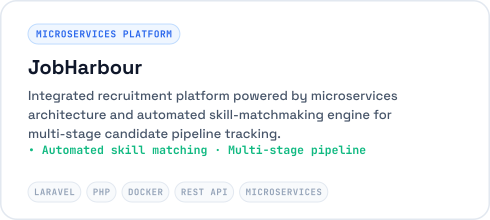

<!-- 
  Muhammad Affif — Backend Systems & Cloud Architecture Engineer
  Crafted with clean, high-performance SVG components.
-->

  

 

  

 

  

 

<h3 align="left">Featured Engineering Initiatives</h3>

  
  

 

  

 

  

 

  🌐 Portfolio: <a href="https://nourivex.tech"><b>nourivex.tech</b></a> (migrating to <a href="https://nour.web.id"><b>nour.web.id</b></a> in December) · <a href="mailto:muhammad321afiff@gmail.com"><b>muhammad321afiff@gmail.com</b></a> 
  © 2026 Muhammad Affif · Auto-synchronized via GitHub Actions.

