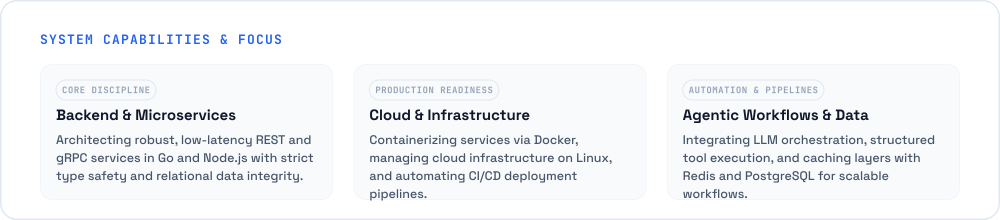
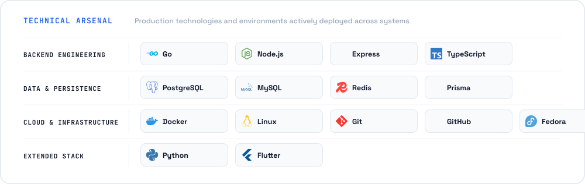
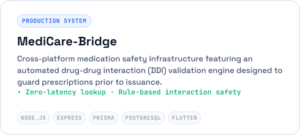
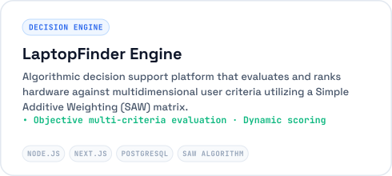
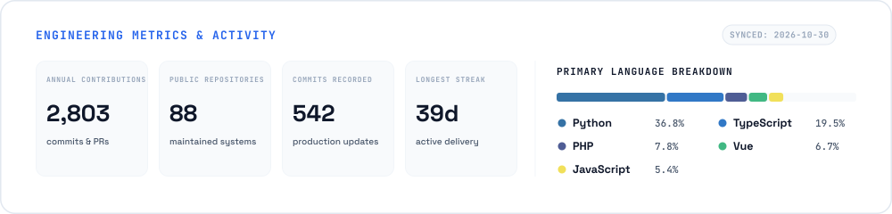

<!-- 
  Muhammad Affif — Backend Systems & Cloud Architecture Engineer
  Crafted with clean, high-performance SVG components.
-->

  

 

  

 

  

 

<h3 align="left">Featured Engineering Initiatives</h3>

  
  

 

  

 

  

 

  © 2026 Muhammad Affif · Designed with focus on clarity, engineering performance, and reliability.

