<!--
        ╭──────────────╮
        │  ʕ•ᴥ•ʔ  ▍   │   oh, hi. you opened the source.
        ╰──────┬───────╯   nouri noticed.
               │
   ACHIEVEMENT UNLOCKED · SOURCE READER

   how the level works (no fake numbers):
     xp    = lifetime_contributions × 10 + stars × 50
     level = floor( sqrt(xp / 100) ) + 1
   refreshed daily by .github/workflows/nourivex.yml

   this file is generated — edit profile.config.json, then run: node scripts/build.mjs
-->

<a name="top"></a>

<div align="center">
  
</div>

<p align="center">
  <a href="#about"></a>
  <a href="#loadout"></a>
  <a href="#quests"></a>
  <a href="#stats"></a>
  <a href="#contact"></a>
</p>

<p align="center">
  <b>Backend Systems Engineer</b> from Indonesia · Systems that hold. Deploys that ship. Nouri keeps watch.<br>
  <sub>Go · Node.js · Express · Cloud Architecture & Agentic Workflows · Open to collaborate</sub>
</p>

<a name="about"></a>


<a name="loadout"></a>


<a name="quests"></a>


<p align="center">
  <a href="https://github.com/nourivex/MediCare-Bridge"></a>
  <a href="https://github.com/nourivex/LaptopFinder"></a>
</p>

<a name="stats"></a>


<a name="contact"></a>


<p align="center">
  <a href="mailto:muhammad321afiff@gmail.com"></a>
</p>

<a href="SECRET.md"></a>

<details>
<summary><code>$ open terminal</code></summary>

```console
nouri@nourivex:~$ whoami
Muhammad Affif — Backend Systems Engineer · Cloud Architecture & Agentic Workflows

nouri@nourivex:~$ cat nouri.txt
N.O.U.R.I  =  Node Observability & Uptime Runtime Interface
role     :  companion process. keeps builds green, guards the p99.
uptime   :  online by day · hibernates after 22:00 UTC+7
traits   :  allergic to merge conflicts, unindexed queries, and TODO: fix later

nouri@nourivex:~$ ls -la ./stack/
drwxr-xr-x  go/          node.js/     postgres/    docker/
drwxr-xr-x  redis/        prisma/      typescript/  linux/
drwxr-xr-x  python/       flutter/     fedora/      github/

nouri@nourivex:~$ cat ./quest_log.txt
[ QUEST 01 ] MediCare-Bridge ............. IN PROGRESS
[ QUEST 02 ] LaptopFinder Engine ......... IN PROGRESS
[ NEXT    ] ??? .......................... LOCKED

nouri@nourivex:~$ nouri --inspect
[ DIAGNOSTICS: NOURI COMPANION CORE ]
• firmware : v2.4.0-cyber-arctic
• visor-mode : CHILL (cyan)
• energy    : 35% (auto-sync: day 6)
• uptime    : 967 days, 1 hrs
• easter-egg: visit SECRET.md for Curious Cat achievement

nouri@nourivex:~$ sudo hire nourivex
[sudo] password for recruiter: ********
checking clearance..................... ✓
validating stack alignment............. ✓
confirming timezone compatibility...... ✓ (UTC+7, responsive during business hours)
✓ ACCESS GRANTED: head back up and hit the SAVE POINT

nouri@nourivex:~$ exit
nouri: safe travels. Drop by at night, the amber LED means standby mode.
```

<kbd>↑</kbd> <kbd>↑</kbd> <kbd>↓</kbd> <kbd>↓</kbd> <kbd>←</kbd> <kbd>→</kbd> <kbd>←</kbd> <kbd>→</kbd> <kbd>B</kbd> <kbd>A</kbd>
<sub>&nbsp; cheat accepted: +30 lives. unfortunately, bugs respawn too.</sub>

</details>

<p align="right"><a href="#top"><sub>▲ back to boot screen</sub></a></p>
