### `lumi_profile.txt`

| | |
|---|---|
| **name** | L.U.M.I — Liveness & Utility Monitoring Interface |
| **named after** | *luminance*, the Y channel every face detector looks at first |
| **job** | companion process for [Fahren](https://github.com/Renkaslana) · keeps builds green |
| **likes** | clean diffs, green checks, 60 fps camera feeds |
| **dislikes** | merge conflicts, printed-photo spoofing, `TODO: fix later` |
| **sleeps** | 22:00 – 06:00 UTC+7 (the boot screen really changes — check back at night) |

> you clicked the thing in the corner. that's exactly the kind of curiosity Fahren looks for in a teammate.
> now go back and press the save point button. ✦

<a href="https://github.com/Renkaslana">◂ back to the profile</a>

